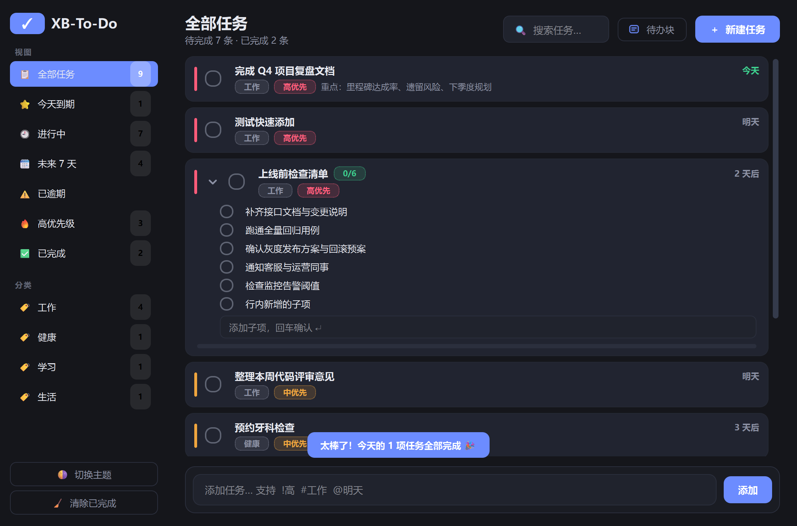

# XB-To-Do 待办清单

一款基于 **PySide6 (Qt 6)** 的 Windows 桌面待办应用。单机运行、数据本地存储、无需联网，
支持**待办块**（一个块里放多条待办）、优先级、分类、到期提醒、全局搜索与亮 / 暗双主题。

<p align="center">
  
  
</p>

---

## 快速开始

### 方式一：安装包

运行 `XB-To-Do-1.0.0-Setup.exe`，按向导完成安装，然后从开始菜单或桌面快捷方式启动。

卸载从「设置 → 应用」里进行，卸载时会询问是否一并删除任务数据。

### 方式二：源码运行

需要 Python 3.10 及以上版本。

```bat
pip install -r requirements.txt
python main.py
```

也可以直接双击 **`启动.bat`**，它会自动查找 Python（跳过 Microsoft Store 的占位程序）、
检查依赖缺失并询问是否自动安装，然后启动应用。

想先看看效果，可以加 `--demo` 写入一组示例任务：

```bat
python main.py --demo
```

## 使用

### 快捷键

| 快捷键 | 功能 |
| --- | --- |
| `Ctrl+N` | 新建任务 |
| `Ctrl+B` | 新建待办块 |
| `Ctrl+F` | 聚焦搜索框 |
| `Ctrl+T` | 切换亮 / 暗主题 |
| `Ctrl+Q` | 退出应用 |
| `Enter` | 快速添加栏 / 子项输入框提交 |
| 双击任务 | 编辑该任务 |

### 快速添加

在底部输入框一行内组合使用标记，回车即创建：

| 语法 | 含义 | 示例 |
| --- | --- | --- |
| `!高` `!中` `!低` | 优先级（也支持 `!h` `!m` `!l` 或 `!3` `!2` `!1`） | `!高` |
| `#分类名` | 所属分类 | `#工作` |
| `@日期` | 到期日，支持自然语言 | `@明天` `@周五` `@10-20` `@3天后` |

示例：

```
交季度复盘文档 !高 #工作 @明天
```

### 待办块

按 `Ctrl+B` 或点顶栏的「待办块」，可以一次录入多条子待办。

- 卡片上显示完成进度 `2/5` 与进度条，点箭头展开 / 收起
- 子项可勾选、双击重命名、悬浮删除，底部输入框回车可连续添加
- 勾选整块即一键完成全部子项；子项全部完成时整块自动标记完成，取消任一子项则整块回到未完成

### 设置

点侧边栏的「⚙ 设置」：

| 分组 | 可配置项 |
| --- | --- |
| 外观 | 主题（深色 / 浅色）、界面语言 |
| 新任务默认值 | 优先级、分类、到期日 |
| 行为 | 启动时进入的视图 |

界面语言可切换为 English；语言文件独立存放在 `app/lang/` 目录，
把新的 JSON 语言文件放进数据目录的 `lang` 文件夹即可新增语言，无需改动程序。

## 数据

| 内容 | 位置 |
| --- | --- |
| 任务数据库 | `%APPDATA%\CodeXB\XB-To-Do\tasks.db`（SQLite） |
| 窗口位置 / 主题等设置 | 注册表 `HKCU\Software\CodeXB\XB-To-Do`（QSettings） |

数据库是单文件 SQLite，直接复制即为完整备份，覆盖回去即恢复。也可以用 `--db` 指定其他路径：

```bat
python main.py --db D:\data\my-tasks.db
```

---

© 2026 CodeXB
